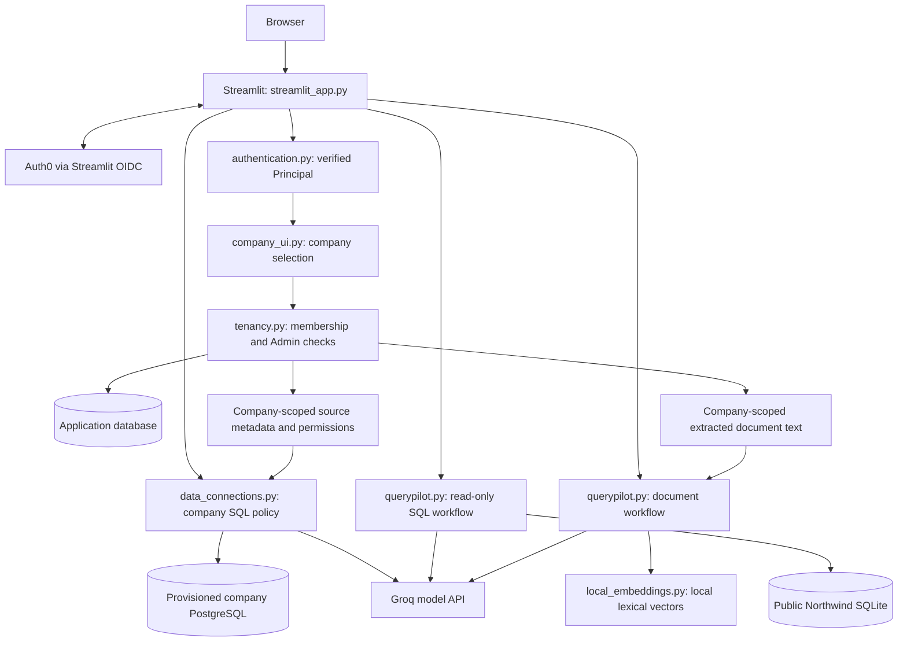
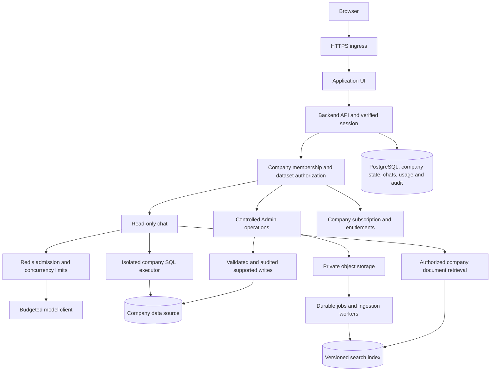

# QueryPilot architecture

Last updated: **2026-10-28**  
Current checkpoint: **company PostgreSQL sources and table/column permissions**

This is the starting point for developers, AI coding agents, and anyone learning
the project. It describes the running implementation separately from the target
SaaS design. Source code is the authority for behavior; update this document in
the same change whenever behavior or architecture changes.

## 1. Product and terminology

QueryPilot lets people ask natural-language questions about structured data and
documents. The target product serves multiple companies through one platform.

- **Company / tenant / workspace:** the same isolation boundary in this project.
  The database and service code use `company_id`.
- **User:** a person identified by the identity provider. A user can belong to
  several companies.
- **Membership:** the user's role in one company. Roles are not global.
- **Admin:** manages that company's membership and published documents.
- **User role:** reads that company's published documents and uses read-only chat.
- **Platform operator:** a planned operational role, not an implemented customer
  role or a grant of unrestricted customer-data access.

Example: Alice can be an Admin in Company A and a User in Company B. Her access
to A never grants access to B.

## 2. Implementation status

| Capability | Status | Boundary / limitation |
| --- | --- | --- |
| Streamlit SQL and document chat | Implemented | One server application; no dedicated API yet |
| Auth0 OIDC authentication | Implemented | Real deployment callback still needs verification |
| Private email allowlist | Implemented, default | Independent of company membership |
| Verified-user registration mode | Implemented, opt-in | No domain-based automatic membership |
| Company creation and switching | Implemented | Creator becomes first Admin |
| Company Admin/User roles | Implemented | Checked in backend store methods |
| Invitations and role changes | Implemented | Single-use code, 24-hour expiry; no email delivery |
| Last-Admin protection | Implemented | Concurrent-demotion tests currently use SQLite |
| Company document publishing | Implemented | Extracted text persisted; Admin-only replacement |
| Company change audit records | Implemented | Stored records; no audit viewer or full change rollback |
| Application database | Implemented | SQLite locally; PostgreSQL adapter not integration-tested |
| SQL over public Northwind | Implemented | Same public sample for all companies |
| Company PostgreSQL sources and table/column permissions | Implemented with deployment validation pending | Provisioned credentials; company-wide allowlists; PostgreSQL calls mocked in tests |
| Per-member dataset grants and other database connectors | Planned | Members currently share their company's published policy |
| Admin business-record editing | Planned | No write tools in chat |
| Persistent chats and central session revocation | Planned | Chat and retrieval indexes are session-local |
| Redis, token accounting, billing | Planned | No enforced shared AI budgets yet |
| Object storage and ingestion workers | Planned | Parsing/indexing currently synchronous |
| PostgreSQL RLS and versioned migrations | Planned | Isolation currently enforced by application services |

Do not describe the complete production SaaS design below as already deployed.

## 3. Current runtime



Streamlit currently owns UI rendering and calls Python services directly. There
is no FastAPI service in the main application. The older FastAPI/Node examples
are independent demos, not the main app's backend.

The **application database** and **Northwind database** have different purposes.
Never point the SQL agent at the application database containing identities,
memberships, invitations, documents, or audit events.

## 4. Repository map

| Path | Responsibility |
| --- | --- |
| [streamlit_app.py](streamlit_app.py) | Main entrypoint, mode selection, upload parsing, chat rendering, Groq configuration |
| [authentication.py](authentication.py) | Auth configuration validation, verified identity policy, session cleanup |
| [company_ui.py](company_ui.py) | Company onboarding/selection, invitation and role forms, cached database resource |
| [tenancy.py](tenancy.py) | SQLAlchemy schema, company authorization, transactions, invitations, document persistence, audit writes |
| [querypilot.py](querypilot.py) | SQL generation/execution, chunking, retrieval, document answers |
| [data_connections.py](data_connections.py) | Company-bound secret references, PostgreSQL transport/role checks, SELECT policy, bounded results, authorization rechecks |
| [data_source_ui.py](data_source_ui.py) | Admin schema inspection/publishing/removal; SQL source selection and context invalidation |
| [local_embeddings.py](local_embeddings.py) | Offline 4,096-dimensional hashed word/word-pair vectors; lexical rather than semantic retrieval |
| [requirements.txt](requirements.txt) | Dependencies for the main Python app |
| [.env.example](.env.example) | Environment configuration template; contains no real credentials |
| [.streamlit/secrets.toml.example](.streamlit/secrets.toml.example) | Auth0 and application access-policy template |
| [check_local_auth.py](check_local_auth.py) | Local configuration diagnostics |
| [local_auth_server.py](local_auth_server.py) | Development-only auth troubleshooting launcher |
| [docs/company-workspaces.md](docs/company-workspaces.md) | Company setup and current operational limitations |
| [docs/data-sources.md](docs/data-sources.md) | Customer connection provisioning, TLS, permissions, supported SQL and validation limits |
| [docs/auth0-setup.md](docs/auth0-setup.md) | Provider and callback setup |
| [docs/production-design.md](docs/production-design.md) | Additional identity/deployment design notes |
| [SQL-AGENTS](SQL-AGENTS) | Legacy JavaScript SQL examples and public Northwind data |
| [VECTORSTORE-AGENT](VECTORSTORE-AGENT) | Legacy TypeScript document agent and public SOLID example |
| [VECTORSTORE-CHAT](VECTORSTORE-CHAT) | Legacy Python FastAPI/WebSocket chat and archived examples |

Legacy examples have their own dependencies and authentication gaps. They are
not protected by the main app's Auth0/company checks and should stay outside the
production deployment.

## 5. Identity, roles, and isolation rules

1. Streamlit/Authlib verifies OIDC identity. Application code consumes that
   verified identity; it does not trust unsigned JWTs or browser user IDs.
2. `Principal.user_id` is a SHA-256 identifier derived from `(issuer, subject)`.
   Email is an access-policy/invitation value, not the permanent identity key.
3. `CompanyStore.register()` persists the current verified account.
4. Membership determines the role in the selected company.
5. Company read/write methods check membership; administrative methods also
   require `admin`. The UI is not the authorization boundary.
6. A submitted `company_id` selects a resource; it does not authorize access.
7. Company or role changes clear session workspace inputs, chats, indexes, and
   entered API keys. Account changes, expiry, and logout also clear session data.
8. Chat remains read-only for Admins and Users. Future writes must use validated,
   separately authorized management operations.

| Operation | User | Admin |
| --- | --- | --- |
| Use SQL Chat over public Northwind | Yes | Yes |
| Read an approved company PostgreSQL dataset | Yes | Yes |
| Inspect a provisioned connection and publish/remove its table/column policy | No | Yes |
| Ask questions about published company documents | Yes | Yes |
| Read another company's documents | No | No |
| Publish/replace company documents | No | Yes |
| List company members, invite, change roles | No | Yes |
| Update/delete customer business records | Not implemented | Not implemented |

The final Admin cannot be demoted. Invitations are bound to the recipient's
verified email, expire in 24 hours, and are consumed once. Only token hashes are
persisted. Accepting another invitation does not change an existing membership's
role. No invitation email is sent automatically.

## 6. Current data model and state

Tables are defined in `tenancy.py`:

| Table | Important fields / purpose |
| --- | --- |
| `users` | `id`, `issuer`, `subject`, `email`; unique issuer/subject |
| `companies` | `id`, `name`, document `revision` |
| `memberships` | Composite key `(company_id, user_id)`; `admin` or `user` role |
| `invitations` | `token_hash`, `company_id`, `email`, `role`, `expires_at` |
| `company_documents` | Composite key `(company_id, position)`; source label and extracted text |
| `company_audit_events` | Company, actor, action, target, event time |
| `company_data_sources` | Composite `(company_id, id)`; name, secret reference, schema, approved-columns JSON, policy revision |

Company creation, membership changes, invitation operations, source saves/removals,
and document replacement write audit events in the corresponding transaction. Company writes
serialize on a company row in PostgreSQL; SQLite uses `BEGIN IMMEDIATE` and
enabled foreign keys. No database RLS policy is installed yet.

| State | Where it lives |
| --- | --- |
| Identities, roles, invitations, published text, audit events | Application database |
| Chat history, retrieval vectors, current UI state, entered API key | Streamlit server session memory |
| Uploaded original file bytes | Temporary upload/session memory; not durably retained |
| Public sample SQL data | `SQL-AGENTS/data/northwind.db` |
| Customer SQL data | Customer PostgreSQL; not copied to the application database |
| Customer connection metadata and permissions | Application database; no credential URLs stored |
| Customer credential URLs | Company-bound deployment secret mapping in `QUERYPILOT_DATA_CONNECTIONS` |
| Deployment credentials | Environment/ignored Streamlit secrets; never this document |

Only the database engine/store resource is shared through Streamlit resource
caching. Do not globally cache a user's identity, private index, uploads, chat,
or credentials.

## 7. Main flows

### Sign in and select a company

```text
Auth0 login -> verified Principal -> application access policy
-> register account -> list memberships -> select company -> check role
-> clear stale company state -> show permitted workspace
```

The default access policy is `allowlist`. Explicit `verified_users` mode lets any
verified account create a company. An existing company still requires an
invitation. New accounts without membership see onboarding, not chat.

### SQL question

The source selector offers approved company PostgreSQL sources and the explicit
public Northwind sample. The company connector never uses the application DB.
Only Company Admins may inspect a provisioned connection or publish permissions.
Platform operators assign credentials to a full company ID before the reference
appears to that company's Admins. URLs cannot be submitted through the UI.

```text
Verify membership -> load company-scoped source and permission fingerprint
-> expose only approved schema -> generate PostgreSQL SELECT
-> parse and qualify against approved columns -> revalidate rewritten AST
-> recheck membership/policy -> execute rewritten SQL in read-only transaction
-> bound response -> recheck membership/policy -> display or discard results
```

Supported customer SQL is a single non-nested SELECT with ordinary ON joins,
filters, grouping, ordering, and selected built-in functions. Wildcard projections
expand to approved columns. CTEs, subqueries, UNION, casts, windows, custom
functions, system objects, whole-row references, NATURAL/USING joins, and writes
are rejected. Source or policy/binding changes clear SQL history; changes during
execution cause results to be discarded. Permissions currently apply to all
company members equally, including Admins.

PostgreSQL uses a dedicated restricted role, verified TLS, a five-second connect
timeout, three-second statement timeout, lock/idle timeouts, a server cursor,
200 returned rows, and a one-MiB row-data response budget. The byte budget is
checked after each row is decoded; it is not a hard process-memory limit.
Elapsed time is checked between fetches; already-running work is not revoked
instantly. Raw connection/database errors are sanitized rather than sent to the
model. SQLGlot is pinned to major version 30; upgrades require policy regression
testing. Detailed setup/limits: [data sources](docs/data-sources.md).

The public sample retains its original SQLite workflow:

```text
Check membership -> load public sample schema -> generate structured SQL
-> read-only execution -> at most one correction after an execution error
-> recheck membership before displaying the answer
```

SQLite runs in read-only/query-only mode with an authorizer, a three-second
execution deadline, and a 200-row response limit. Only the last six conversation
messages are passed as history. These are not token or spending limits.

### Publish documents and ask questions

```text
Admin upload -> check combined upload size -> extract PDF/TXT/Markdown text
-> chunk and build local index -> Admin check in persistence operation
-> atomically replace company text and write audit event
-> members load company text into their session-local retrieval index
```

Uploads are capped at 10 MB during indexing, and published text is separately
bounded at 10 MB and 300 chunks. Parsing still happens inside the application
process. Blank/scanned PDFs need suitable extracted text or future OCR support.

Without uploads, Admin indexing uses existing company text, or the public SOLID
sample if none exists. Users cannot publish. Retrieval selects four chunks;
follow-up questions may first be rewritten by the model. Groq receives the
question and selected context; SQL generation also sends schema and may send
failed SQL/error context. Uploaded content is treated as untrusted prompt data.

Replacing documents does not erase excerpts already displayed in session-local
chat. Persisting original files, document deletion, retention, and history purging
remain separate future features.

## 8. Configuration and running

| Setting | Purpose |
| --- | --- |
| `APP_ENV` | `development` enables local database defaults; otherwise production restrictions apply |
| `DEV_AUTH_BYPASS` | Only works with explicit development mode; forbidden in production |
| `QUERYPILOT_DATABASE_URL` | Application DB; production requires `postgresql+psycopg://...` |
| `QUERYPILOT_DATA_CONNECTIONS` | Private JSON mapping full company IDs to connection references and plain PostgreSQL URLs |
| `PGSSLROOTCERT` | Optional libpq CA-file configuration for verified customer-database TLS |
| `GROQ_API_KEY` | Server AI credential; user-entered key can override it in the session |
| `GROQ_MODEL` | Initial model value; the UI currently permits editing it |
| `[auth]` in Streamlit secrets | Provider/client/callback/cookie settings |
| `[app_auth].access_mode` | `allowlist` by default, or explicit `verified_users` |
| `[app_auth].allowed_emails` | Required for allowlist mode |
| `[app_auth].max_session_seconds` | Identity-age policy; default eight hours, also bounded by claim expiry |

Development creates ignored `.querypilot/application.db` if no DB URL is set.
Production requires PostgreSQL and an initialized schema. `python tenancy.py`
creates missing tables, including `company_data_sources` for an existing deployment;
it is not a versioned migration system and does not alter existing table layouts.

```powershell
.\.venv\Scripts\python.exe -m pip install -r requirements.txt
# Configure .env and .streamlit/secrets.toml using their example files.
# For production, initialize the configured application database once:
# .\.venv\Scripts\python.exe tenancy.py
.\.venv\Scripts\python.exe -m streamlit run streamlit_app.py
```

Never commit actual `.env`, `secrets.toml`, application DB files, invitation
codes, customer text, or provider credentials. Use the detailed setup guides for
provider registration and deployment. A running app is not proof of production
readiness.

## 9. Target SaaS architecture — planned



The API must independently verify callers; forwarding a `st.user` dictionary is
not authentication. Keep one modular backend and a worker deployment initially.

### Planned Redis and AI controls

- Atomic per-user/per-company request limits, renewable concurrency leases, and
  provider/model limits. Company-scoped keys also include permission/version
  context where cached data depends on access.
- PostgreSQL remains authoritative for durable usage and cost reservations.
- Check user, company, and global spend ceilings before invoking a model.
- Count every model attempt, including rewriting, SQL correction, and retries.
- Set input/output token limits and a server-owned model allowlist. Reserve cost
  before execution, settle actual usage afterward, and reconcile uncertain calls.
- Keep evictable caches separate from critical control state. Cache failure may
  fall back to storage; unavailable admission controls should block new AI work.

These controls do not exist yet. Proposed limits from design discussions are not
current enforced quotas.

### Planned customer data and lifecycle

- Company-bound credential references and table/column checks now exist. Managed
  secret-provider integration/rotation, per-member dataset grants, other database
  types, network egress enforcement, and private connectors remain future work.
- Separate read-only SQL credentials and scoped Admin-write credentials. Arbitrary
  connected databases do not automatically support editing.
- Private file storage, bounded parser workers, reliable/idempotent jobs, atomic
  version publishing, deletion, and retention policies.
- Persistent private conversations, centralized sessions/revocation, membership
  removal, invitation revocation, and stronger Admin reauthentication.
- Company subscriptions, seats, storage/AI allowances, verified payment events,
  and fair worker scheduling across companies.
- PostgreSQL RLS, versioned migrations, operational monitoring, backups, restore
  drills, and deployment rollback. Dedicated enterprise isolation can follow.

## 10. Verification and known gaps

```powershell
.\.venv\Scripts\python.exe -B -m unittest test_data_connections test_tenancy test_querypilot test_streamlit_app test_groq test_authentication test_local_auth_server -v
.\.venv\Scripts\python.exe -m pip check
```

| Test file | Main coverage |
| --- | --- |
| [test_tenancy.py](test_tenancy.py) | Company isolation, User restrictions, role changes, invitations, concurrency, persistence, onboarding, company switching |
| [test_data_connections.py](test_data_connections.py) | Company source isolation, SQL/column policy, mocked PostgreSQL transport and privilege checks, result limits, permission races, source UI/history |
| [test_authentication.py](test_authentication.py) | Auth settings, claims policy, account changes, expiry, logout |
| [test_streamlit_app.py](test_streamlit_app.py) | Main chat modes, publishing/indexing, rendering, server-key non-disclosure |
| [test_querypilot.py](test_querypilot.py) | SQL safety/limits, correction, chunking, retrieval |
| [test_groq.py](test_groq.py) | Mocked model request/response handling |
| [test_local_auth_server.py](test_local_auth_server.py) | Safe local diagnostics behavior |
| [test_company_support.py](test_company_support.py) | Isolated database fixtures, not a standalone test suite |

Last recorded verification: **52 tests passed; dependency checks passed** during
the PostgreSQL-source checkpoint on 2026-10-28. This is a recorded result, not an
automatically refreshed badge.

Tests use local SQLite and mocked model/provider/PostgreSQL interactions. No
PostgreSQL server was available for connector integration checks. They do not prove
real Auth0 callbacks, PostgreSQL TLS/role behavior, cursor timeouts, concurrency/isolation, load capacity, recovery,
or secure public self-service operation. Complete those checks and shared abuse
controls before broad public rollout. Native logout is not global revocation,
and rerun checks do not interrupt operations already in progress.

## 11. Next checkpoints

1. Validate customer PostgreSQL integration and extend dataset grants/connectors as needed.
2. Controlled Admin data changes and stronger audit review.
3. Redis admission controls and durable AI token/cost accounting.
4. Private file storage, background ingestion, deletion, and retention.
5. Persistent chats, session revocation, and API separation when needed.
6. Subscriptions, operational readiness, and measured scaling.

## 12. Maintenance contract

For every feature, fix, or refactor that changes behavior, permissions, storage,
configuration, integration, or deployment:

1. Read this file before implementation and verify the relevant source files.
2. Update the affected sections in the same change; do not only append history.
3. Keep **implemented**, **partially implemented**, and **planned** claims explicit.
4. Update file/table maps, flows, limits, setup, tests, and known gaps as needed.
5. Add one dated entry below and update the last-updated date. Record checks
   actually run and distinguish mocked/local checks from deployed verification.
6. Update detailed guides when affected. Do not duplicate secrets or private data.

Documentation-only changes can record link/consistency checks without rerunning
unrelated runtime tests. The repository's [AGENTS.md](AGENTS.md) instructs future
coding agents to follow this contract; maintainers should apply it in review too.

## 13. Architecture change log

| Date | Change | Validation / remaining limits |
| --- | --- | --- |
| 2026-10-28 | Company workspace foundation: persistence, Admin/User membership, switching, invitations, published company text and audit events | 39 tests and dependency checks passed; PostgreSQL deployment validation pending |
| 2026-10-28 | Established this central architecture reference and repository documentation-update instructions | Documentation link/consistency checks; no runtime changes |
| 2026-10-28 | Added company PostgreSQL sources, Admin policy inspection/publishing/removal, restricted SELECT execution, source-change history clearing, and deployment-owned secret references | 52 tests and dependency checks passed; PostgreSQL transport mocked, live deployment validation pending |
