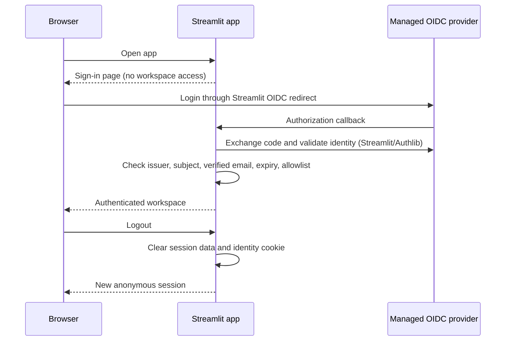

# QueryPilot production design

## Scope and rollout

Start with the existing Streamlit application and managed OpenID Connect (OIDC)
authentication. Auth0 Universal Login is the chosen provider. Enable email/password, Google,
or other supported connections in Auth0; the application uses one OIDC flow.
Avoid a frontend/backend rewrite until independent API clients or background work
justify one. The legacy demos are separate applications and are not protected by
the main app's authentication.

| Stage | Components | Completion criteria |
| --- | --- | --- |
| 1: Identity | Managed OIDC, application access policy, session boundaries | Anonymous access blocked; expiry and logout tested; real provider callback verified in deployment |
| 2: Persistent users and workspaces | PostgreSQL users keyed by issuer/subject, workspaces, memberships | Database migrations, tenant ownership checks, cross-tenant tests |
| 3: Document storage and ingestion | Private object storage, per-workspace indexes, queue and workers | Upload limits, ownership checks, deletion and retention policies |
| 4: AI request control | Server-side Groq client, per-user quotas, concurrency and retry limits | Spend ceilings, rate limiting, model failure tests |
| 5: Operations | TLS ingress, private app service, secret manager, metrics, backups | Restore drill, health checks, alerts, deployment rollback |

Only stage 1 is being implemented in this iteration. Other rows describe intended
work, not existing production capabilities.

## Authentication boundary

Streamlit/Authlib owns authorization-code handling, state, nonce, token signature
validation, audience validation, and signed identity cookies. QueryPilot consumes
only framework-authenticated identity claims; it never accepts a browser-supplied
user ID, decoded unsigned JWT, or API key as user authentication.

The stable account identity is `(issuer, subject)`. Email is a verified access
policy input and display value, not a permanent database key. The first release
uses an explicit email allowlist for private access. Future workspace roles must
come from server-owned membership records, not UI controls or arbitrary claims.

Require authentication by default. Missing or invalid configuration must block
workspace access. A development bypass requires both `APP_ENV=development` and
`DEV_AUTH_BYPASS=true`; it must be absent in production.

Check identity expiry on each Streamlit rerun. Clear session data on logout,
expiry, authorization rejection, or principal changes. Session-local uploads,
vectors, histories, and any user-entered Groq key must never be cached globally.
The configured server Groq key must never be passed into a rendered input widget.

## Deployment requirements and limits

Use an HTTPS public origin and register the exact `/oauth2callback` URL with the
identity provider. Use a strong unique cookie signing secret, consistent across
replicas. Store client secrets and cookie secrets in the deployment secret
manager or Streamlit secrets, never Git. Do not expose provider tokens to the UI.

Native Streamlit identity cookies can persist for 30 days, independently of token
expiry. Application checks must reject expired identities. Logout affects the
current session; it does not centrally revoke every open tab or device. Rerun
checks do not interrupt work already in progress. Hard idle timeouts, immediate
global revocation, and organizational session policies require a shared session
store or enforcing identity-aware ingress in a later iteration.

The public health endpoint is a liveness signal, not proof of authentication or
Groq readiness. Test the browser sign-in/callback/logout flow on the real origin
before describing this deployment as production ready. Add external ingress rate
limits, application quotas, security event logging with redaction, operational
monitoring, and persistence/backup validation before broad public rollout.

## Next data model

`users(id, issuer, subject, created_at)` has a unique constraint on
`(issuer, subject)`. `workspaces(id, name)` and
`memberships(user_id, workspace_id, role)` define authorization. Documents, vector
indexes, and conversations carry `workspace_id` and an owner where appropriate.
Every API or worker operation must derive the user from a verified server-side
session and check membership before reading or writing data. An authenticated
user must never gain access merely by changing a resource identifier.
